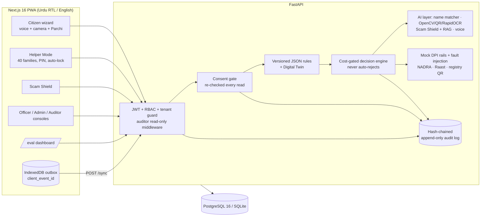

# The Last Mile: AI on Public Rails

> **PROTOTYPE — Simulated DPI & Synthetic Data Only.** No real CNICs, phone numbers, government systems or personal data are used anywhere. Every name, CNIC, phone number, QR code and SMS in this repository is synthetic.

**One sentence:** a low-literacy widow can apply for a relief grant by Urdu voice and a CNIC photo on a weak connection, a shopkeeper can check whether a "relief payment" SMS is a scam, and a community helper can safely manage up to 40 families on one shared phone — all on a multi-tenant, consent-gated platform where the AI can recommend but never reject.

Built for **Coder's Cup 2026** (48-hour hackathon). Not a chatbot: server-side RBAC, revocable consent middleware, versioned JSON rules, a cost-gated decision engine and a hash-chained, append-only audit log.

---

## Contents
1. [Architecture](#architecture) · 2. [Setup](#setup) · [Deployment](#deployment) · 3. [Test credentials](#test-credentials) · 4. [Real vs. Simulated](#real-vs-simulated) · 5. [Decision engine & threshold derivation](#decision-engine--threshold-derivation) · 6. [Evaluation results](#evaluation-results) · 7. [Live demo](#live-demo) · 8. [Limitations](#honest-limitations) · 9. [API map](#api-map)

---

## Architecture



| Layer | Path | Highlights |
|---|---|---|
| Core security | `backend/app/core/` | JWT access/refresh, bcrypt, RBAC deps, tenant IDOR guard, consent gate, token-bucket limiter, audit chain |
| Models | `backend/app/models/` | 15 tables, `tenant_id` on every tenant-owned table, Alembic migration in `backend/alembic/` |
| Engine | `backend/app/services/` | `rules_engine.py`, `decision_engine.py`, `digital_twin.py`, `case_pipeline.py`, `identity.py`, `documents.py`, `voice.py` |
| AI | `backend/app/ml/` | `name_matcher.py`, `vision.py`, `scam_shield.py` (+ `policies/*.md` for RAG), `anomaly.py` |
| Frontend | `frontend/app/`, `frontend/components/`, `frontend/lib/` | citizen, helper, scam, officer, admin, auditor, receipt, eval pages; `offlineDb.ts` + `sync.ts` outbox |
| Evaluation | `backend/scripts/generate_eval_cases.py`, `run_eval.py`, `backend/eval/` | 546 cases, 13 families, metrics JSON |

## Setup

Requirements: Python 3.11+ (tested on 3.14), Node.js 20+ (tested on 26 LTS). Docker is optional.

```bash
# 1. Backend
python -m venv .venv
.venv/Scripts/pip install -r backend/requirements.txt          # Windows; use .venv/bin/pip on macOS/Linux
cd backend
python scripts/seed_demo.py --families 40                      # 2 tenants, 5 roles each, helper with 40 families
python -m uvicorn app.main:app --port 8000                     # http://localhost:8000/docs

# 2. Frontend (new terminal)
cd frontend
npm install
npm run build && npm start                                     # http://localhost:3000

# 3. Tests, evaluation and demo rehearsal (from backend/)
python -m pytest -v                                            # 126 tests, incl. the frontend build
python scripts/generate_eval_cases.py && python scripts/run_eval.py
python scripts/verify_demo_script.py                           # against the running server
```

**Real-browser E2E (Playwright, headless Chromium).** `cd frontend && npx playwright install chromium && npm run test:e2e`. Playwright starts its own servers on dedicated ports (API :8010 on a fresh, freshly-seeded throwaway database; production PWA build on :3010), so it never touches a dev server on 3000/8000. The 7 tests in `frontend/tests/e2e_browser.spec.ts` cover:

- Urdu/English RTL layout with bounding-box overlap checks on desktop and phone widths
- speaker buttons that must not navigate and must request audio
- the citizen application with the `Muhammed` spelling variant, blurry-then-clean CNIC upload and the QR Parchi
- the offline outbox (`setOffline`) syncing exactly once
- Helper Mode family switching with PINs
- Scam Shield samples
- the officer queue, citizen consent take-back (403), admin Digital Twin and fault toggles, auditor hash chain and the `/eval` charts

Every test fails on any uncaught page error, `console.error` or unexpected API 4xx/5xx. Fixtures are regenerated with `python backend/scripts/make_e2e_fixtures.py`.

**SQLite is the default** (zero setup). For PostgreSQL: `docker compose up -d db`, set `DATABASE_URL` from `.env.example`, then `alembic upgrade head` (or let the dev server create the schema). `postgres://` and `postgresql://` URLs are normalised to the psycopg 3 driver automatically. To run the whole test suite on Postgres: `TEST_DATABASE_URL=postgres://user@host:5432/lastmile_test python -m pytest` (that database is wiped). Optional tooling: `python scripts/generate_voice_assets.py --force` regenerates the Urdu/English prompt MP3s (needs internet once).

## Deployment

| Piece | Where | How |
|---|---|---|
| Backend + PostgreSQL 16 | **Render** (`render.yaml` Blueprint) or **Railway** (`railway.toml`) | Docker image from `backend/Dockerfile`, built from the repo root. Each boot runs `alembic upgrade head && python scripts/seed_demo.py --families 40 && uvicorn …`; migrations and seeding are idempotent, so restarts never create duplicates. |
| Frontend PWA | **Vercel** | Root directory `frontend`, framework Next.js, env `NEXT_PUBLIC_API_URL=https://<your-backend-host>` (see `frontend/.env.example`). |

Backend environment variables: `DATABASE_URL` (provider URL as-is), `JWT_SECRET` (long random), `FRONTEND_URL` (comma-separated deployed origins, e.g. `https://last-mile.vercel.app`), optional `CORS_ORIGIN_REGEX` (e.g. `https://.*\.vercel\.app` for preview deployments). `http://localhost:3000` and `http://127.0.0.1:3000` are always allowed. The image bundles the Urdu/English prompt MP3s and pre-downloads the RapidOCR models, so neither needs network at runtime.

**Free-tier image pipeline (512 MB RAM, fractional CPU).** The PWA resizes phone photos on a `<canvas>` to at most 1024 px and re-encodes them as JPEG (quality 0.82) before upload. A 4000-px, 1.2 MB photo becomes about 50 KB, which suits 2G. Small images are sent untouched so forensic metadata survives.

The backend has four safeguards:
- It downscales anything above 1024 px before OpenCV or RapidOCR runs, and decodes very large files at reduced resolution.
- It keeps one RapidOCR instance that runs one inference at a time on one thread (`OCR_THREADS`), and calls `gc.collect()` afterwards.
- It caches each image's analysis by hash, so the photo check and the submit upload don't OCR the same photo twice.
- Any memory or engine error becomes a `vision_engine_failure` flag, which routes the case to `ESCALATE_HUMAN` ("I am not sure") instead of crashing.

**Verify a deployment:** `python backend/scripts/verify_demo_script.py --base https://<api>` and `cd frontend && E2E_BASE_URL=https://<web> E2E_API_URL=https://<api> npx playwright test`. Both drive the live services and write synthetic data.

## Test credentials

Password for every synthetic account: **`Demo@1234`**

| Role | Sindh Social Protection | Punjab Relief Dept |
|---|---|---|
| Citizen (widow) | `sindh.citizen` | `punjab.citizen` |
| Community helper | `sindh.helper` | `punjab.helper` |
| Department officer | `sindh.officer` | `punjab.officer` |
| Platform admin | `sindh.admin` | `punjab.admin` |
| Auditor (read-only) | `sindh.auditor` | `punjab.auditor` |
| Helper families | `sindh.family01` … `family40` (citizen logins) | `punjab.family01` … |

Family PINs (shared-phone unlock/consent) follow the seed rule `family N → f"{1000 + N*7:04d}"[-4:]`: family01 = `1007`, family02 = `1014`, family03 = `1021`, … (printed by `seed_demo.py`).

## Real vs. Simulated

| Capability | Status | Notes |
|---|---|---|
| Multi-tenant RBAC, JWT, tenant/IDOR isolation | **Real** | Enforced in FastAPI dependencies + global auditor middleware |
| Revocable consent gate | **Real** | DB re-check on every read; field-level redaction; audited |
| Hash-chained append-only audit log | **Real** | SHA-256 chain + ORM guard + SQLite/Postgres triggers; `/audit/verify-chain` |
| Versioned rules + Digital Twin | **Real** | Publishing = version+1 instantly; simulations never write |
| Cost-gated decision engine | **Real** | Deterministic math; explanations + full trace |
| Fuzzy name matching | **Real** | RapidFuzz Jaro-Winkler + Urdu normalisation + phonetic skeleton |
| Blur / glare / dark detection, QR decode, image-hash reuse | **Real** | OpenCV on the actual pixels |
| OCR | **Real** (RapidOCR 3, ONNX) | Tesseract not required. Test fixtures may embed deterministic OCR text for speed |
| Forgery detection | **Partly real** | Editing-software metadata + QR/registry + hash reuse are real; the ELA heuristic is weak on synthetic cards and only nudges scores |
| Scam Shield classifier + RAG | **Real model, synthetic data** | TF-IDF + LogisticRegression trained on 205 synthetic SMS; extractive RAG over simulated policy markdown |
| Anomaly model | **Real model, synthetic data** | IsolationForest on a synthetic applicant population |
| Urdu voice prompts | **Real audio** | 12 MP3s pre-generated with gTTS, served offline by the PWA |
| Speech-to-text | **Browser Web Speech API** | Server normalises the transcript (Urdu digits, number words, CNIC, yes/no); Whisper not bundled |
| Offline outbox + idempotent sync | **Real** | IndexedDB + `client_event_id`; replay-safe `/sync` |
| NADRA identity, Raast payments, registry QR | **Simulated** | `/mock/*` rails over a 50-row synthetic registry with deliberate dirty data |
| CNIC check digit | **Simulated** | Real CNICs have no public checksum; a documented synthetic rule is used |
| Policies, short code 8171, helpline 0800-26477 | **Simulated** | Used only inside synthetic messages/policies |
| Fault injection (NADRA timeout, Raast error, low OCR) | **Simulated** | Admin toggles to demonstrate graceful human escalation |

## Decision engine & threshold derivation

Four transparent sub-scores feed a composite probability `p`:

| Sub-score | Source | Weight |
|---|---|---|
| `rule_score` | hard + soft conditions of the active rule version | 0.35 |
| `identity_match_score` | CNIC + fuzzy name + father name vs. registry | 0.30 |
| `document_score` | `ocr_confidence × quality_score × (1 − forgery_score)` | 0.20 |
| `1 − anomaly_score` | IsolationForest + duplicate CNIC/registry heuristics | 0.15 |

**Min-guard:** `p = min(weighted_mean, weakest_sub_score + 0.15)`, so one severe red flag cannot be averaged away.

**Costs** (in units of one officer review): Wrong Approval **20**, Wrong Block **5**, Human Review **1**, Slow Proof Delay **0.5**.

* **AUTO_RECOMMEND threshold.** Auto-recommending a case with probability `p` costs `(1 − p) × 20` in expectation; sending it to a human costs `1`. Auto is cheaper iff `(1 − p) × 20 < 1` ⇔ **`p > 1 − 1/20 = 0.95`**.
* **ASK_MORE_PROOF threshold.** Asking costs the delay plus, if the proof does not resolve it, a review and another delay: `0.5 + (1 − p) × (1 + 0.5)`. This beats escalation (`1`) iff `1 − p < 1/3` ⇔ `p > 0.667`, rounded up to **0.70** for a safety margin.

**Routing** (only three outcomes exist — the engine has no reject route):

| Route | When |
|---|---|
| `AUTO_RECOMMEND` | `p ≥ 0.95` **and** all hard rules pass **and** zero anomaly flags. Money still moves only on an officer's 1-tap `/disburse`. |
| `ASK_MORE_PROOF` | `0.70 ≤ p < 0.95`, or a fixable gap (blurry/dark/glare photo, low OCR, missing field, malformed CNIC), or a soft anomaly (statistical outlier, weak forensic signal) |
| `ESCALATE_HUMAN` | `p < 0.70`, hard-rule failure, tamper/QR mismatch/duplicate CNIC/duplicate document, identity mismatch, name-spelling conflict band (0.72–0.89), prompt injection, or a DPI timeout — with an "I am not sure, you have not been rejected" message |

Only a department officer can reject, and a rejection requires a written reason. Every decision stores `reason_user` (two short sentences, English + Urdu) and a `trace_json` with the rule version, model versions, sub-scores, min-guard status, flags, expected costs and an `inputs_hash`.

## Evaluation results

`python scripts/run_eval.py` runs **546 synthetic cases across 13 families** through the real API and engine on an isolated database (fresh schema per family). Latest run: **546 / 546 expectations met**, zero auto-rejections, ~50 s.

**Cost-threshold sweep** (cases whose route is forced by a flag are threshold-independent):

| AUTO threshold | Wrong approvals | Eligible escalated | Eligible delayed by proof | Human review load | Total expected cost |
|---|---|---|---|---|---|
| 0.75 | 0 | 14 | 104 | 132 | 257.0 |
| 0.85 | 0 | 14 | 104 | 132 | 257.0 |
| 0.90 | 0 | 14 | 104 | 132 | 257.0 |
| **0.95 (chosen)** | **0** | **14** | **104** | **132** | **257.0** |
| 0.98 | 0 | 14 | 108 | 132 | 259.0 |

Honest reading: in this cohort every fraud case is caught by an explicit flag, so 0.75–0.95 **tie** on cost and 0.98 only adds proof requests for genuine applicants. We keep **0.95**: it is the safest threshold among the cheapest and the one the cost derivation predicts. The sweep does not prove 0.95 is uniquely optimal in the real world — it shows the trade-off on a designed synthetic cohort.

The suite also changed the engine. Its first run passed 524/546 and exposed four real issues, now fixed:

1. Impostors were asked for more proof instead of being escalated (new `identity_mismatch` flag).
2. Malformed CNICs typed by different people were treated as duplicates.
3. The anomaly model penalised eligible incomes near the cap (biased training population).
4. Subtle forgeries (forgery score 0.1) could be auto-recommended (new `forensic_signal` soft flag).

| Scam Shield (42 held-out phrasings) | Value | Document forensics (84 cases) | Value |
|---|---|---|---|
| Precision (SCAM verdict) | 100% | Precision | 100% |
| Recall, hard SCAM verdict | 65.4% | Recall | 100% |
| Recall incl. human review | 100% | False-alarm rate (14 clean controls) | 0% |
| False-alarm rate | 0% | | |
| Genuine notices sent to review | 12.5% | | |

These numbers come from synthetic data that the same team generated. Treat them as regression checks, not as real-world accuracy. The `/eval` page shows the charts, tiles and the per-family table.

## Live demo

`backend/scripts/verify_demo_script.py` executes all 23 steps of the 4.5-minute judge demo against the running server and stops at the first surprise (also safe to re-run on the same database):

1. Urdu welcome audio plays offline; consent is OFF until the widow turns it on.
2. She says "pandrah hazar" → 15,000 with a mandatory read-back.
3. Her father's name is spelled "Mohammad" vs. "Muhammad" in the registry — tolerated.
4. A blurry CNIC photo gets an Urdu retake tip; the retake with a valid QR → `AUTO_RECOMMEND`.
5. Her green Parchi has a 6-digit PIN and a signed QR; the officer sees the Input/OCR/Registry diff and the trace.
6. A Raast error fails safely; the officer's 1-tap disbursement then pays.
7. The admin flips "NADRA timeout": the next case becomes a human handoff, never a rejection.
8. Shopkeeper: the Roman-Urdu fee SMS → SCAM with the "No Fee Is Ever Charged" citation; an injection SMS is blocked.
9. Helper Mode: the family PIN unlocks family A; consent for A does not open family B.
10. Offline outbox replay creates exactly one case.
11. "Who has my data": revoking consent locks the officer out on the very next request.
12. Digital Twin, then publishing a new rule version; the old decision still cites its version.
13. The auditor cannot write; the hash chain verifies; the evaluation summary loads.

## Honest limitations

* **Synthetic everything.** Models are trained and evaluated on data we generated; real-world accuracy is unknown. The threshold sweep illustrates trade-offs on a designed cohort.
* **Forgery detection is shallow.** ELA does not separate spliced from clean synthetic cards; real protection comes from QR/registry cross-checks, hash reuse and metadata. A careful forger who strips metadata and has a valid QR is not detected.
* **The Scam Shield is template-bound.** Recall on hard SCAM verdicts is 65% on held-out phrasings (the rest go to human review). Novel scam styles will degrade it.
* **No income verification against the registry.** Under-reported income is not cross-checked yet.
* **Voice.** STT depends on the browser's Web Speech API (not available on all phones/offline); dynamic TTS needs internet (pre-cached prompts do not).
* **Helper auto-lock and the 40-family switcher are client-side UX.** The server still enforces consent on every request, but a stolen unlocked phone can act within the 2-minute window.
* **In-memory state.** Rate limiter and fault switches are per-process (single-instance prototype); production needs Redis or similar.
* **PostgreSQL verified locally, not in CI.** The suite (118 DB-backed tests), Alembic migrations, idempotent re-seeding across two simulated boots, the append-only trigger and the 23-step demo were run against PostgreSQL 16.13; the default CI-style run uses SQLite.
* **Docker image not built in this environment** (no Docker available). The dependency set was resolved for Linux x86-64 on Python 3.11–3.14 (wheels only), but the first real build happens on your host/Render.
* **Browser coverage is headless Chromium on desktop/phone viewports.** Real phones (Android WebView/Safari), real microphones and Urdu speech recognition are not automated: the continuous dictation flow still needs a manual check on a device.

## API map

Interactive docs: `http://localhost:8000/docs`. Main groups:

`/auth/*` login/refresh/me · `/cases` submit/list/read · `/consents` grant/list/revoke · `/cases/{id}/documents` upload + forensics · `/vision/check` live retake check · `/decisions/{id}/trace` · `/cases/{id}/officer-action`, `/cases/{id}/disburse` · `/officer/queue`, `/officer/cases/{id}/review` · `/helper/families`, `/helper/families/{id}/unlock`, `/helper/lock` · `/sync` · `/cases/{id}/receipt`, `/receipts/verify` · `/rules/{scheme}`, `/rules/{scheme}/publish`, `/rules/simulate` · `/scam/check`, `/public/scam/check` (API key), `/policy/ask` · `/voice/tts`, `/voice/stt`, `/voice/prompts` · `/admin/faults`, `/admin/api-keys` · `/audit/logs`, `/audit/verify-chain` · `/mock/identity/verify`, `/mock/payment/initiate`, `/mock/registry/qr/{code}`, `/mock/ocr/extract` · `/eval/summary`, `/eval/by-family`, `/eval/run` · `/public/schemes` (API key, rate-limited)

---

*PROTOTYPE — Simulated DPI & Synthetic Data Only.*
